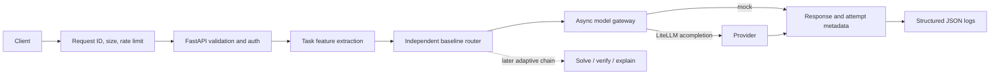

# System design

The research policy selects a model tier before inference. The gateway handles provider protocol, usage, timeout, retry, and optional fallback. The current adapter calls LiteLLM's async `acompletion` directly and disables nested retries with `num_retries=0` and `max_retries=0`. The LiteLLM Router separately provides deployment-level retries/fallbacks; its routing function is not used as the thesis query-level quality policy. See [LiteLLM async SDK](https://docs.litellm.ai/docs/python_sdk) and [retry/fallback behavior](https://docs.litellm.ai/docs/router/learn/reliability).

## Components

- `app/features.py`: deterministic query features; no API/provider dependency.
- `app/routing.py`: always-small, always-strong, deterministic request-hash random, and rule baselines.
- `app/settings.py`: Pydantic Settings, secret values, validation, production fail-closed constraints.
- `app/gateway.py`: async deterministic mock and LiteLLM adapters, typed usage/cost/attempt records, bounded retries and one-shot fallback.
- `app/service.py`: tutoring use case, prompt separation, orchestration, response mapping.
- `app/middleware.py`, `app/rate_limit.py`: request correlation, a 65,536-byte streamed body cap, and bounded per-process sliding window.
- `app/observability.py`: JSON logs without question text, credentials, or raw provider errors.
- `app/main.py`: HTTP routing, auth dependency, exception mapping, and health/strategy endpoints.

## Reliability and trust boundaries

Client text is sent in the user message, separately from the system instruction. It is treated as untrusted content. Student questions and authorization headers are not logged. Incoming request IDs are syntax-checked; invalid IDs are replaced. Request validation errors do not echo the submitted input.

Retries are limited to transient/rate-limit/timeouts; authentication and malformed-response errors are not retried. The primary can be attempted at most `max_retries + 1` times; one optional fallback model is attempted once. Attempts preserve their own model, latency, status, usage, and cost metadata. Responses separately expose aggregate attempt cost and final-attempt cost. Aggregate numeric totals are null when any attempt is unknown; known subtotals and unknown-attempt counts remain explicit. Provider messages and tracebacks are not included in client errors.

Rate limiting is a process-local in-memory sliding window keyed by client address. It does not coordinate multiple workers or replicas. Readiness checks validated local configuration without making provider calls.

The optional budget setting fails closed for real calls because no verified model/token price estimator is configured. LiteLLM calculated costs are labeled as calculated; they are not billing statements. Production requires bearer auth, non-empty credentials, HTTPS for a configured API base, and a non-mock provider.

## Limits

No live provider call has been verified. The default mock returns a marker, not an answer. There is no learned quality router, durable telemetry, distributed rate limiting, dataset ingestion, or dynamic budget optimization.

The body guard buffers no more than 65,536 bytes per tutor request before replaying the body to FastAPI, so limits apply to streamed bodies and do not depend on Content-Length. The process-local limiter stores at most 4,096 client windows and one shared overflow window; overflow traffic remains rate limited but shares that window.
