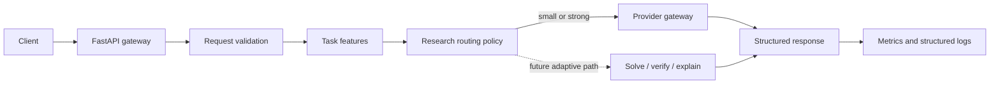

# System design (Phase 0)

The policy chooses a tutoring strategy/model tier. The gateway owns provider protocol, usage collection, timeout, retry, and provider fallback. LiteLLM is the planned adapter for those deployment concerns; its current documented router selects deployments/model groups and handles retries/fallbacks, while this project's policy predicts per-query tutoring needs.

Initial implementation packages: `app/features.py`, `app/routing.py`, `app/gateway.py`, `app/main.py`, and `app/schemas.py`. Feature extraction and routing have no FastAPI dependency. The current gateway is mock-only; provider-specific claims are intentionally deferred until an adapter is configured and exercised.

Operational constraints: keep credentials in environment/secrets, avoid logging raw student questions by default, carry a request ID, bound request size, and treat question text as untrusted prompt content. Authentication is a minimal optional bearer check; rate limits, privacy retention, retries, budget enforcement, and observability are not implemented yet.
